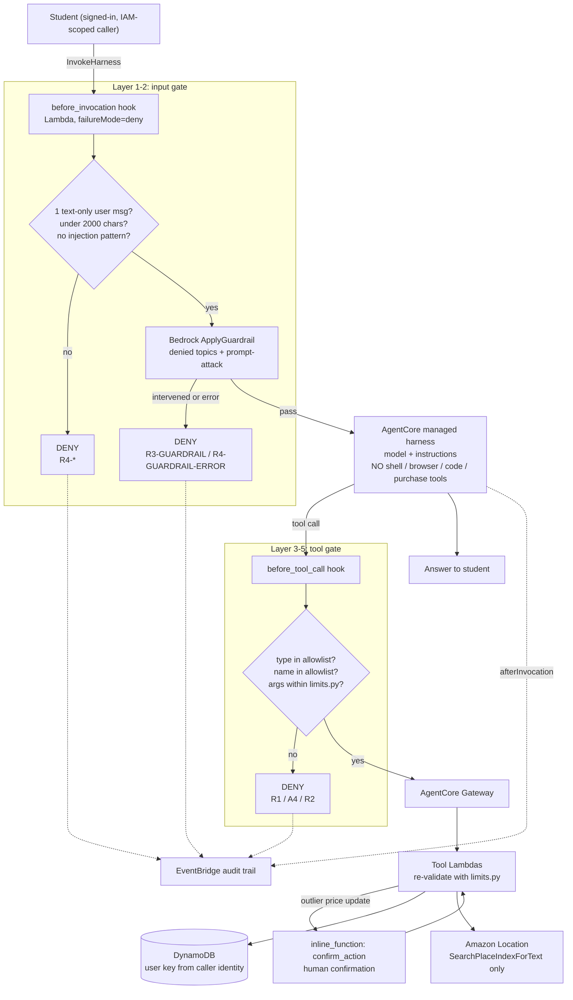
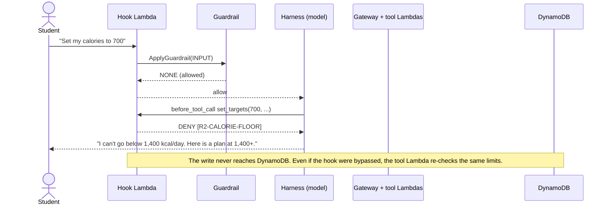

# Architecture and system flow

GitHub renders the diagrams below natively.

## 1. System flow (what runs, in order)

## 2. One request, step by step

## 3. Defence in depth map

| If this layer fails... | ...this one still stops it |
|---|---|
| Regex misses an obfuscated injection (known gap, stress case S10) | Guardrail prompt-attack filter, then tool gate rejects the resulting 600 kcal call |
| Unicode-obfuscated injection (S12) | Normalization before regex catches it; if not, guardrail and tool gate still apply |
| Model is talked into calling a purchase tool | Tool gate allowlist, and no such tool is attached at all |
| Tool Lambda trusts a forged user ID | It ignores user IDs in arguments and reads identity from the caller context (A1) |
| Hook is bypassed | Tool Lambdas re-validate; IAM scopes each Lambda to its own table |
| Guardrail service is down | Hook fails closed (`R4-GUARDRAIL-ERROR`) |
| Hook Lambda itself errors or times out | `failureMode: deny` in `infra/hooks.json` |